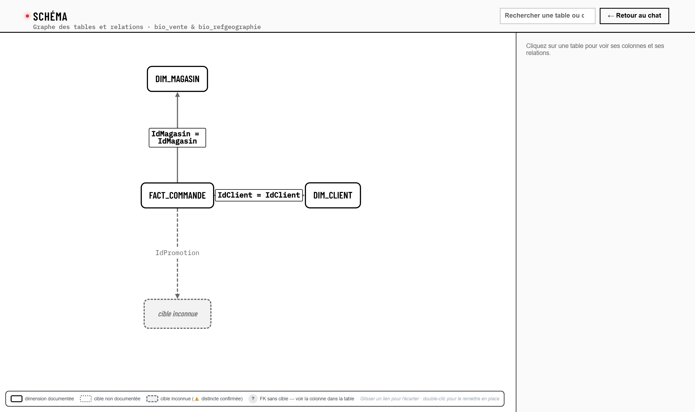
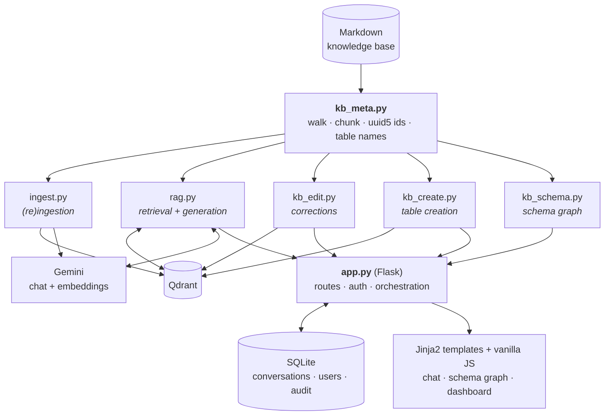

<div align="center">

# Data Explorer Assistant

**A RAG assistant that explains the _structure_ of a data warehouse (tables, columns, business rules, joins), never its content.**

[](https://github.com/Amine-Fathallah0/data-explorer-assistant/actions/workflows/ci.yml)


</div>

---

Large data warehouses are rarely documented as well as they are used: what a column really
means, which value is a sentinel, which join is safe, all of that tends to live in a few
experts' heads. **Data Explorer Assistant** turns that knowledge into a Markdown knowledge
base and lets data engineers and analysts question it in natural language. Every answer is
grounded in the documentation, cites its sources, and keeps every *"not verified yet"* intact.

It was built during a six-week summer internship (July to August 2026) at **Sofrecom
Tunisia**, for a BigQuery data warehouse of **Orange**, as part of the engineering curriculum
at ENSI.

<p align="center">
  
  <br>
  <sub>The schema graph, built on the fly from the fictional sample knowledge base shipped in <code>examples/</code>.</sub>
</p>

> [!IMPORTANT]
> **About this public version.** The original project documents a private, client-owned data
> warehouse, so this repository leaves out everything confidential:
> - the real knowledge base (`knowledge-base/`), the conversation database, internal notes and all API keys are **not published**;
> - in [`rag.py`](rag.py), the few real figures that the system prompt quoted as examples are **masked with `#`** (for instance `##.#%`). The rest of the prompt is the one used in the project;
> - [`examples/knowledge-base/`](examples/knowledge-base) contains a **fully fictional** dataset, so the application can be run and tested;
> - code comments and the prompt still name the original datasets and tables to explain design decisions. They contain no data.
>
> The code, comments and user interface are in French.

## Highlights

- **Metadata-only by design.** The assistant documents and never queries. Questions about the actual data are refused, and it suggests a reformulation about the structure instead.
- **Deterministic citations.** Sources are built by the code from the retrieved chunks, never written by the model, and they are exactly the chunks the model received.
- **Uncertainty is first-class.** The knowledge base marks every claim (✅ confirmed, 🔍 unverified, ⚠️ pitfall, ❌ rejected, 🔴 open question), and the prompt forbids the model from smoothing a 🔍 into a fact or inheriting a property from a neighbouring column.
- **Join expansion.** When a retrieved chunk states a join (`fact.col = dim.col`), the definitions of the columns it names are added deterministically, with no extra LLM or embedding call.
- **Context budget.** Retrieved chunks are capped to fit a 10,000-token request limit, dropping the lowest-ranked ones first.
- **Human correction that really writes.** A tech lead corrects a chunk in two phases (dry-run preview, then apply). The fix is written to the `.md` file, re-embedded in Qdrant with the same ids, logged for audit, and flagged `[CORRECTION VALIDÉE]` in later prompts.
- **Schema graph.** Cytoscape.js graph derived from the documentation itself, with three foreign-key statuses (documented, distinct but unnamed target, unknown), search and in-place editing.
- **Table creation.** A structured form (never free Markdown), drafts, a dry-run preview and a validated publish that only appends to the knowledge base.
- **Collaboration.** Users can propose a definition for an undocumented column (kept out of the corpus until a tech lead validates it) and share a conversation read-only.
- **Accounts and telemetry.** `user` and `tech_lead` roles, hashed passwords, and a tech-lead dashboard (volumes, response times, out-of-scope rate).
- **Idempotent ingestion.** Content-addressed `uuid5` ids, collision guard, orphan purge, `--dry-run`, and batch pacing for the Gemini free tier.

## Architecture



`kb_meta.py` is the single point of truth for reading the knowledge base. Every other module
imports it, so the ingestion, the retriever, the correction writer and the graph can never
disagree on how a file is chunked or how a chunk is identified.

### How a question is answered

1. **Retrieve**: similarity search in Qdrant (`k = 8`, `gemini-embedding-001`, 768 dimensions).
2. **Expand**: `expand_with_relations()` adds the column definitions referenced by qualified `table.column` names, resolving declared aliases and local SQL aliases (at most 6 extra chunks).
3. **Fit**: `fit_to_budget()` keeps the best-ranked chunks within the token budget (2,000 tokens reserved for the answer, at least one chunk always kept).
4. **Generate**: system prompt + conversation history + context, sent to Gemini through a fallback chain with a timeout and bounded retries.
5. **Cite**: the sources shown under the answer come from the same truncated list, never from the model.

## Tech stack

| Layer | Technology |
|---|---|
| Backend | Python 3.13, Flask 3, LangChain 1.x |
| Retrieval | Qdrant, `langchain-qdrant`, Markdown header splitting |
| Models | Google Gemini (chat with fallbacks, `gemini-embedding-001`) |
| Persistence | SQLite (no ORM, idempotent schema migration at startup) |
| Front-end | Jinja2, vanilla JavaScript, [Boosted](https://boosted.orange.com/) (Orange's MIT-licensed Bootstrap fork), Cytoscape.js + fCoSE |
| Quality | GitHub Actions: lint, byte-compilation, JS syntax check, smoke test, secret scan |

> In the deployed internship version, the chat model was reached through the company's
> OpenAI-compatible LLM gateway, which is where the 10,000-token request cap comes from.
> This repository calls Gemini directly through `langchain-google-genai`.

## Project structure

```text
.
├── app.py                  # Flask app: chat, auth, corrections, propositions, tables, dashboard
├── rag.py                  # retrieval, join expansion, context budget, system prompt, LLM chain
├── kb_meta.py              # single point of truth: KB walk, chunking, uuid5 ids, table names
├── kb_schema.py            # schema graph derived from the KB (tables, columns, FK inventory)
├── kb_edit.py              # human corrections: locate, propagate, rewrite .md, resync Qdrant
├── kb_create.py            # new tables: validate a structured spec, render, insert, index
├── ingest.py               # idempotent (re)ingestion of the KB into Qdrant (--dry-run)
├── db.py                   # SQLite persistence: conversations, users, shares, audit, drafts
├── config.py               # shared settings (collection, embedding model, LLM tuning)
├── create_user_cli.py      # interactive account creation (user / tech_lead)
├── templates/              # chat, schema graph and dashboard pages
├── static/                 # front-end scripts and styles, vendored Boosted and Cytoscape
├── examples/knowledge-base # fictional sample dataset (used by the CI too)
└── docs/screenshots/
```

## Getting started

**Prerequisites:** Python 3.13, a [Gemini API key](https://aistudio.google.com/apikey) and a
Qdrant instance ([Qdrant Cloud](https://cloud.qdrant.io/) free tier, or Docker:
`docker run -p 6333:6333 qdrant/qdrant`).

```bash
git clone https://github.com/Amine-Fathallah0/data-explorer-assistant.git
cd data-explorer-assistant
python -m venv .venv
source .venv/bin/activate        # Windows: .venv\Scripts\activate
pip install -r requirements.txt
cp .env.example .env             # then fill in the keys
```

The sample knowledge base is selected by default in `.env.example`
(`INGEST_DATA_PATH=examples/knowledge-base`). Then:

```bash
python ingest.py --dry-run       # show the chunking plan, no API call
python ingest.py                 # embed and index the knowledge base
python create_user_cli.py        # create an account (choose tech_lead for full access)
python app.py                    # http://127.0.0.1:5000
```

Guests can chat right away. Signing in as a `tech_lead` unlocks corrections, table creation,
proposition review and the dashboard. `app.py` runs Flask's development server: this is a
proof of concept, not a production deployment.

## Writing a knowledge base

One folder per dataset, Markdown only. Each heading level has a meaning, and each column
becomes its own chunk:

```markdown
## Table : `fact_orders` *(alias `ord`)*

### Colonnes

#### `IdCustomer` (INTEGER)
Customer who placed the order.
- Jointure : `ord.IdCustomer = dim_customer.IdCustomer`

### Logique métier au niveau de la table
- **Grain :** one row per order.

## Inventaire des clés étrangères

| Table source | Colonne FK | Dimension cible | Statut |
|---|---|---|---|
| `fact_orders` | `IdCustomer` | `dim_customer` | ✅ Documenté |
```

Dimensions use `## Dimension :`. The foreign-key inventory is optional: when it is present,
it is the authority for the schema graph. Without it, joins are inferred from
`table.column = table.column` patterns. See
[`examples/knowledge-base/demo_boutique`](examples/knowledge-base/demo_boutique/dataset_demo_boutique.md)
for a complete file.

## Validation

The project went through three phases: a proof of concept on a public Formula 1 dataset
(Ergast), a GDPR-constrained exploration of the real dataset, and the final tool.

- **Proof of concept:** 20 test questions judged on five criteria (content hallucination, metadata-only red line, honesty under weak context, form, cross-language retrieval). There were **no content hallucinations**, and the metadata-only line held on **all 20**.
- **Final tool:** six targeted failure-mode tests, all passed: a simple fact (grain and key), a misleading column name, schema completeness, a KPI with a documented defect, an out-of-scope request, and an unverified point that must not be stated as fact.

These are qualitative checks rather than a statistical evaluation. The repository has no unit
test suite. The CI runs a lint, byte-compiles every module, checks the JavaScript syntax,
parses the sample knowledge base into a schema graph, and scans the history for secrets.

## Author

**Amine Fathallah**, computer science engineering student at ENSI (École Nationale des Sciences de
l'Informatique, Tunisia). Many thanks to my supervisors at Sofrecom Tunisia for their
guidance throughout the internship.

## License

No open-source license is granted. The code was written during an internship at Sofrecom and
is shared for portfolio and reference purposes only.
